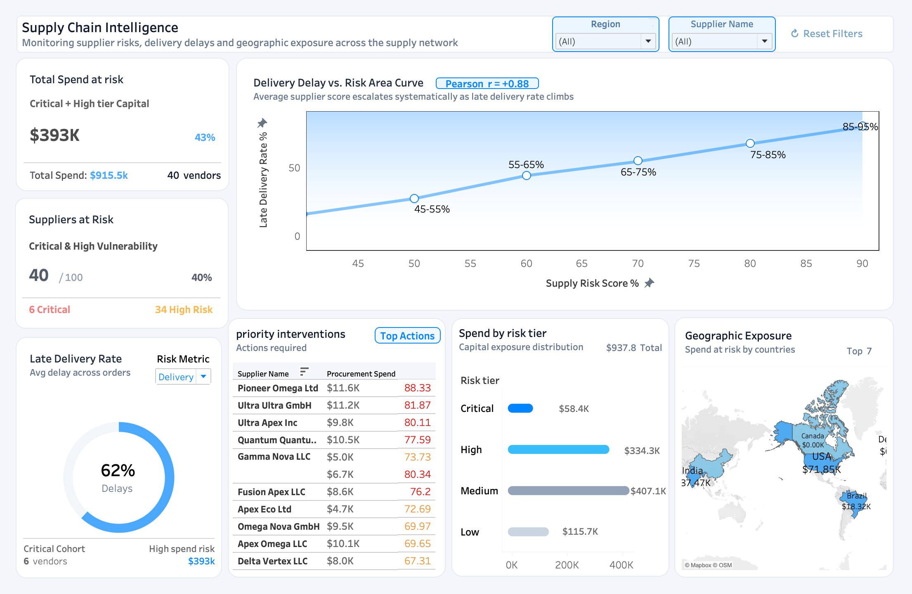

# Supply Chain Disruption Intelligence

A data analytics project focused on identifying supplier risk, delivery disruption, procurement exposure, and geographic concentration across a supply network.

The project combines **Python, MySQL, SQL, and Tableau** to transform raw supply-chain data into an interactive supplier-risk intelligence dashboard.

---

##  Project Overview

Supply-chain disruptions can affect delivery reliability, procurement costs, and operational continuity.

This project analyzes supplier, procurement, sales, product, and customer data to identify:

- Suppliers with elevated delivery risk
- Late-delivery patterns and supplier reliability
- Procurement spend exposed to higher-risk suppliers
- Geographic concentration of supply-chain exposure
- Supplier-level priorities requiring intervention
- The relationship between supplier risk and delivery delays

The final output is an interactive Tableau dashboard designed to support supplier-risk monitoring and prioritization.

---

##  Business Objectives

The analysis was designed around four core objectives:

1. **Identify high-risk suppliers**
2. **Measure delivery reliability and disruption**
3. **Quantify financial exposure associated with supplier risk**
4. **Provide an interactive view for prioritizing supplier interventions**

---

##  Business Questions

The project addresses questions such as:

- Which suppliers have the highest delivery risk?
- How frequently are procurement orders delivered late?
- Which suppliers contribute the most to procurement exposure?
- Does supplier region affect delivery reliability?
- Does certification level relate to supplier delivery performance?
- Do preferred suppliers perform better than non-preferred suppliers?
- Where is supply-chain exposure geographically concentrated?
- How strongly is supplier risk associated with late delivery?
- Which suppliers should be prioritized for intervention?

---

##  Dataset

The project uses five primary datasets:

| Dataset | Description |
|---|---|
| `customer_master.csv` | Customer information and geographic attributes |
| `product_master.csv` | Product and pricing information |
| `supplier_master.csv` | Supplier attributes and delivery-performance information |
| `sales_orders.csv` | Customer sales-order and delivery information |
| `procurement_orders.csv` | Supplier procurement orders, costs, and delivery dates |

A `data_dictionary.csv` file is also included in the raw data layer.

### Dataset Structure

The project separates source data from transformed data:

```text
data/
├── raw/
│   ├── customer_master.csv
│   ├── data_dictionary.csv
│   ├── procurement_orders.csv
│   ├── product_master.csv
│   ├── sales_orders.csv
│   └── supplier_master.csv
│
├── processed/
│   ├── customers.csv
│   ├── products.csv
│   ├── suppliers.csv
│   ├── sales.csv
│   ├── procurement.csv
│   └── supplier_risk.csv
│
└── analytics/
```

`raw/` contains the original source data, while `processed/` contains datasets generated through the Python transformation pipeline.

The `supplier_risk.csv` dataset is the analytical dataset used as the source for the Tableau dashboard.

---

##  Data Pipeline

The project follows a reproducible data workflow:

```text
Raw CSV Data
     ↓
Python Profiling
     ↓
Python Data Cleaning
     ↓
ETL Pipeline
     ↓
Processed CSV Data
     ↓
MySQL Database
     ↓
SQL Analysis
     ↓
Supplier Risk Dataset
     ↓
Tableau Dashboard
```

### 1. Data Profiling

Initial profiling was performed using Python and pandas to examine:

- Dataset dimensions
- Data types
- Missing values
- Duplicate records
- Unique identifiers
- Value distributions
- Categorical distributions
- Delivery-status patterns

Notebook:

```text
python/01_data_profiling.ipynb
```

---

### 2. Data Cleaning

The cleaning stage prepared the datasets for downstream analysis by standardizing fields and addressing data-quality requirements.

Notebook:

```text
python/02_data_cleaning.ipynb
```

---

### 3. ETL Pipeline

The ETL pipeline programmatically:

- Loads the raw CSV datasets
- Standardizes column names
- Converts relevant date fields
- Performs duplicate checks
- Validates primary-key uniqueness
- Writes transformed datasets to the processed data layer

Script:

```text
python/etl_pipeline.py
```

---

##  Python

Python was used for data preparation and pipeline automation.

### Main libraries

- pandas
- pathlib
- mysql-connector-python
- python-dotenv

Python scripts:

```text
python/
├── 01_data_profiling.ipynb
├── 02_data_cleaning.ipynb
├── etl_pipeline.py
├── load_data.py
└── mysql_connection.py
```

`mysql_connection.py` handles database connectivity, while `load_data.py` provides the loading process for transferring processed datasets into MySQL.

Database credentials are stored locally using environment variables rather than being hard-coded into the project scripts.

---

##  MySQL

The processed datasets were loaded into a MySQL database named:

```text
supply_chain_intelligence
```

The database contains tables for:

- Customers
- Products
- Suppliers
- Sales
- Procurement
- Supplier Risk

MySQL was used to create a structured analytical environment and support SQL-based investigation of supplier and procurement performance.

---

##  SQL Analysis

SQL analysis was organized into separate analytical modules:

```text
SQL/
├── 01_data_validation.sql
├── 02_procurement_analysis.sql
├── 03_sales_analysis.sql
├── 04_supplier_analysis.sql
└── 05_product_analysis.sql
```

### Analysis areas

**Data Validation**

Validated table structures, row counts, identifiers, and relationships between datasets.

**Procurement Analysis**

Examined procurement orders, delivery performance, supplier delays, and procurement costs.

**Sales Analysis**

Analyzed order, delivery, revenue, and profitability-related metrics.

**Supplier Analysis**

Focused on supplier reliability, late deliveries, procurement exposure, supplier attributes, and risk prioritization.

**Product Analysis**

Examined product-level characteristics and relationships relevant to the supply network.

---

##  Supplier Risk Analysis

A supplier-level risk dataset was created to bring together supplier characteristics, procurement activity, delivery performance, and financial exposure.

The resulting dataset contains supplier-level metrics used for risk assessment and dashboard visualization.

Key dimensions include:

- Supplier identity
- Country
- Region
- Certification level
- Preferred-supplier status
- Procurement activity
- Eligible procurement orders
- Late procurement orders
- Observed delivery performance
- Procurement cost / exposure
- Supplier risk score
- Risk classification

The risk classification is used to group suppliers into:

```text
Critical
High
Medium
Low
```

This allows suppliers to be prioritized based on their relative operational and financial risk.

---

##  Tableau Dashboard

The final Tableau dashboard provides an interactive view of supplier risk and supply-chain exposure.



### Dashboard Components

#### Total Spend at Risk

Shows procurement capital associated with suppliers classified within the Critical and High risk tiers.

Current dashboard view:

**$393K**

---

#### Suppliers at Risk

Displays the number of suppliers classified as Critical or High vulnerability.

Current dashboard view:

- **40 / 100 suppliers**
- **6 Critical**
- **34 High Risk**

---

#### Late Delivery Rate

Shows the proportion of procurement activity associated with late deliveries.

Current dashboard view:

**62%**

---

#### Delivery Delay vs. Risk Area Curve

Visualizes the relationship between supplier risk score and late delivery rate.

The dashboard currently displays:

**Pearson r = +0.88**

indicating a strong positive relationship between the two variables in the analyzed dataset.

---

#### Priority Interventions

Ranks suppliers requiring attention using supplier risk and procurement exposure metrics.

This view is intended to help decision-makers focus intervention efforts on suppliers with the greatest potential operational or financial impact.

---

#### Spend by Risk Tier

Shows procurement exposure distributed across:

- Critical
- High
- Medium
- Low

This helps distinguish between supplier risk and the amount of capital exposed to each risk tier.

---

#### Geographic Exposure

Maps procurement spend-at-risk across supplier countries.

The dashboard provides a geographic view of supply-chain exposure and highlights the countries contributing to the largest concentrations of risk.

---

##  Dashboard Interactivity

The dashboard includes interactive controls for:

- Region
- Supplier Name
- Risk Metric
- Risk Tier
- Geographic exposure

Dashboard interactions are connected so that selecting a supplier, risk tier, or geographic element can update related views across the dashboard.

A **Reset Filters** control allows the dashboard to return to its default state.

---

##  Key Findings

The completed dashboard highlights several important patterns:

### 1. Delivery disruption is substantial

The dashboard shows a **62% late delivery rate**, making delivery reliability a major operational risk area.

### 2. A significant supplier cohort requires attention

**40 out of 100 suppliers** fall into the Critical or High vulnerability group.

Within this cohort:

- 6 are Critical
- 34 are High Risk

### 3. Financial exposure is concentrated

Critical and High-risk suppliers represent approximately **$393K of spend exposure** in the dashboard's current view.

### 4. Supplier risk and delivery delays move together

The dashboard reports a **Pearson correlation of +0.88** between supply risk score and late delivery rate, showing a strong positive association in this dataset.

### 5. Risk should be evaluated alongside financial exposure

A supplier with a high risk score is not necessarily the largest financial exposure.

Combining **risk severity with procurement spend** provides a more useful basis for prioritizing supplier interventions.

---

##  Business Recommendations

Based on the analysis, organizations could use the dashboard to:

### Prioritize supplier interventions

Focus corrective actions on suppliers combining high risk with significant procurement exposure.

### Strengthen supplier monitoring

Track late-delivery performance regularly for Critical and High-risk suppliers.

### Review supplier concentration

Use geographic exposure to identify regions where disruptions could create concentrated supply-chain impact.

### Evaluate supplier qualification criteria

Compare supplier certification and preferred-supplier status against observed delivery performance rather than relying solely on supplier classifications.

### Establish risk-based procurement strategies

Use supplier risk and financial exposure together when considering supplier diversification, contingency planning, or alternative sourcing.

---

##  Tools & Technologies

| Tool | Purpose |
|---|---|
| **Python** | Data profiling, cleaning, transformation, ETL |
| **pandas** | Data manipulation and analysis |
| **MySQL** | Relational data storage and querying |
| **SQL** | Data validation and business analysis |
| **Tableau** | Interactive dashboard and visualization |
| **Jupyter Notebook** | Exploratory data profiling and cleaning |
| **Git / GitHub** | Version control and project presentation |

---

##  Project Structure

```text
Supply Chain Disruption Intelligence/
│
├── data/
│   ├── raw/
│   ├── processed/
│   └── analytics/
│
├── python/
│   ├── 01_data_profiling.ipynb
│   ├── 02_data_cleaning.ipynb
│   ├── etl_pipeline.py
│   ├── load_data.py
│   └── mysql_connection.py
│
├── SQL/
│   ├── 01_data_validation.sql
│   ├── 02_procurement_analysis.sql
│   ├── 03_sales_analysis.sql
│   ├── 04_supplier_analysis.sql
│   └── 05_product_analysis.sql
│
├── Tableau/
│   ├── supply_chain_intelligence.twbx
│   └── supply_chain_backup.twbx
│
├── documentation/
│   └── supply_chain_dashboard.png
│
├── .gitignore
└── README.md
```

---

##  Security

Database credentials are managed through environment variables using a local `.env` file.

The `.env` file is excluded from version control through `.gitignore`.

**Never commit database passwords, API keys, or other credentials to the repository.**

---

##  Reproducibility

To reproduce the project:

1. Clone the repository.
2. Install the required Python libraries.
3. Place the raw datasets in `data/raw/`.
4. Configure local MySQL credentials through `.env`.
5. Run the ETL pipeline.
6. Load the processed datasets into MySQL.
7. Execute the SQL analysis scripts.
8. Open the Tableau workbook and connect it to the generated analytical dataset.

---

##  Project Outcome

The project demonstrates an end-to-end data analytics workflow:

**Data Collection → Profiling → Cleaning → ETL → Database Loading → SQL Analysis → Risk Scoring → Dashboarding → Business Recommendations**

The final dashboard converts supplier and procurement data into an interactive decision-support tool for identifying delivery risk, financial exposure, and supplier intervention priorities.